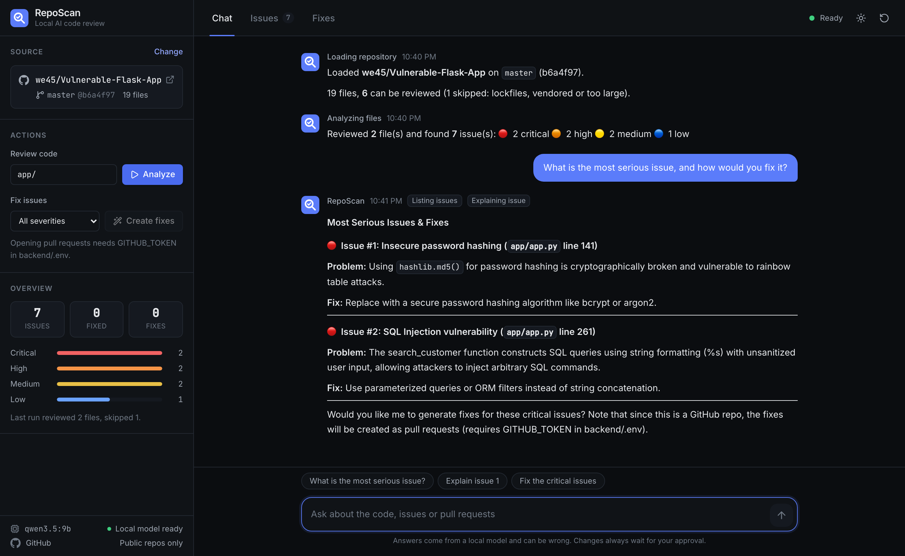
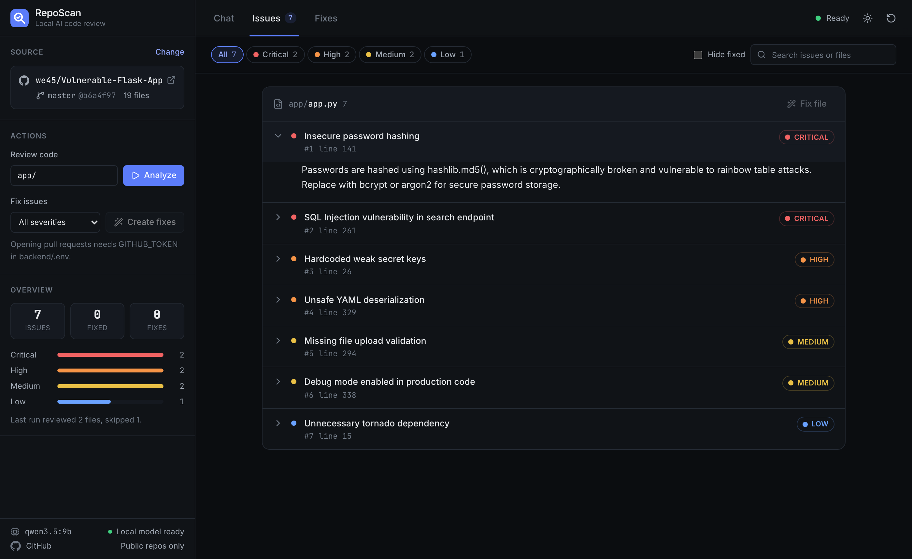
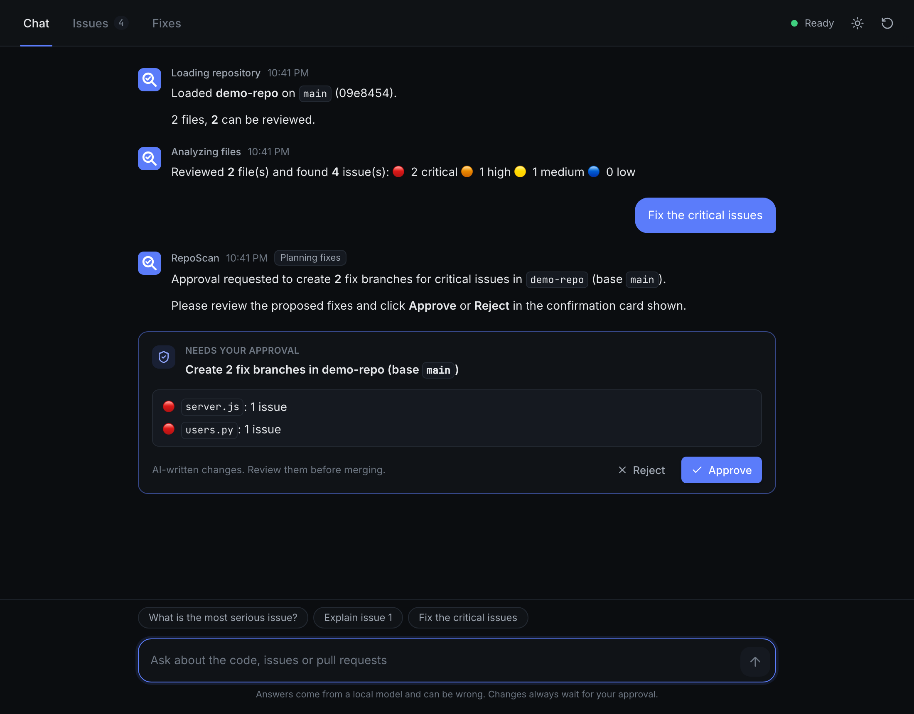
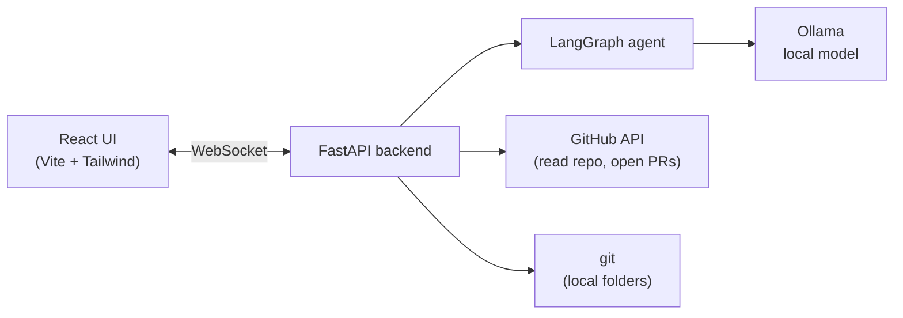

# RepoScan

**AI code review that runs on your own machine.** RepoScan reviews a GitHub repository or a local folder with a local model (via [Ollama](https://ollama.com)), explains what it finds, and prepares fixes as pull requests or git branches. Nothing changes until you approve it.

No code is sent to a cloud AI service, and you don't need an API key.



## Features

- **Two sources.** Review a GitHub repo (by URL or `owner/repo`) or any folder on your machine.
- **Finds real problems.** Bugs, security vulnerabilities, deprecated APIs and risky patterns, each with a severity, a line number and an explanation.
- **Fixes you can review.** Each fixed file becomes its own pull request (GitHub) or git branch (local folder).
- **Works on any public repo.** If you can't push to a repo, RepoScan opens the pull request from your fork, the same way you'd contribute by hand.
- **Approval first.** Every action that writes, merges or closes something shows a confirmation card. Nothing happens until you click Approve.
- **Chat or click.** Ask questions in plain language, or use the buttons for the main steps: load, analyze, fix.
- **Live progress.** See which file is being reviewed, and stop at any time.
- **Light and dark themes**, keyboard friendly, works on mobile.

| Issues by file | Approval before any change |
| --- | --- |
|  |  |

## How it works



1. **Load.** RepoScan lists the files and skips lockfiles, vendored folders, minified bundles and files too large for the model.
2. **Analyze.** Each file goes to the local model, which must answer in a fixed JSON format, so results are never scraped out of free text.
3. **Fix.** For each file, the model proposes small find-and-replace edits. An edit is applied only if its search text matches the file exactly once, so a bad answer can't rewrite or delete large parts of a file. Files with no valid edits are skipped, never committed half-done.
4. **Deliver.**
   - **GitHub:** a branch and a pull request per file. The branch goes in the repo itself if you can push to it, otherwise in your fork (see [Which repos can I open PRs on?](#which-repos-can-i-open-prs-on)).
   - **Local folder:** a branch per file, created with git plumbing commands. Your checked-out branch, working tree and staged changes are never touched. Review with `git diff main...<branch>` and merge when you're happy.

## Safety model

| Risk | How RepoScan handles it |
| --- | --- |
| The model decides to merge, close or delete something | Write tools only *request* an action. It runs after you click **Approve** in the UI. |
| A scanned repo contains hidden instructions ("ignore previous instructions…") | File content is marked as untrusted data in every prompt, and the approval step means injected instructions can't change anything on their own. |
| A website you visit tries to control the local backend | The WebSocket and API only accept requests from allowed origins (`ALLOWED_ORIGINS`). An optional shared token (`REPOSCAN_API_TOKEN`) adds a second check. |
| An AI fix drops code | Fixes are exact find-and-replace edits with size limits. Files over the size limit are skipped rather than truncated. |
| Scanning sensitive folders | Local folders must be inside `LOCAL_ROOTS` (your home folder by default). |
| Closing other people's PRs | Only possible with write access. "Close all PRs" lists the exact PR numbers in the approval card and closes only those. Branches in contributors' forks are never deleted. |
| Writing to repos you don't own | Never pushes to them. Fixes go to your own fork, and the original repo only receives a pull request. |

## Requirements

- **Python 3.11+** and **Node.js 20.19+**
- **[Ollama](https://ollama.com/download)** with a model that supports tool calling. The default is `qwen3.5:9b` (about 6.6 GB, runs well on 16 GB of RAM).
- **git**, for local folders
- Optional: a **GitHub token**, to open pull requests or read private repos (see [GitHub token](#github-token-optional))

## Quick start

**1. Get the model**

```bash
ollama pull qwen3.5:9b
```

**2. Start the backend**

```bash
cd backend
python3 -m venv venv
source venv/bin/activate          # Windows: venv\Scripts\activate
pip install -r requirements.txt
cp .env.example .env              # optional: add GITHUB_TOKEN
uvicorn app.main:app --port 8000
```

**3. Start the frontend** (in a second terminal)

```bash
cd frontend
npm install
npm run dev
```

Open **http://localhost:5173**, paste a GitHub URL or a folder path, and click **Load**.

### GitHub token (optional)

Without a token you can load and review any public repository. You need a token to open pull requests or to read private repos.

| Token type | Use it when | Permissions |
| --- | --- | --- |
| **Fine-grained** (recommended) | You only open PRs on **your own repos** (or your organization's) | Choose the repos, then **Contents** and **Pull requests**: Read and write |
| **Classic** | You also want PRs on **other people's public repos** (from your fork) | `public_repo` scope (`repo` if you need private repos too) |

Create one at [github.com/settings/tokens](https://github.com/settings/tokens), put it in `backend/.env` as `GITHUB_TOKEN=...`, and restart the backend.

### Which repos can I open PRs on?

When you load a repo, RepoScan checks your access and shows it on the source card:

| Badge | What it means | What happens on Create fixes |
| --- | --- | --- |
| **Write access** | Your repo, or one where you're a collaborator or have write access through an organization | Branches are created in the repo, and PRs are opened from them |
| **PRs from your fork** | Someone else's public repo, and you have a classic token | RepoScan forks the repo to your account (once), pushes each fix branch to the fork, and opens the PR against the original repo, with "maintainers can edit" turned on |
| **Read only** | No token, an archived repo, or someone else's repo with a fine-grained token | You can review the code, but Create fixes is disabled, and the panel explains why |

A few rules follow from how GitHub permissions work:

- **Fine-grained tokens can't open PRs on repositories you don't own.** That's a GitHub limitation, so RepoScan tells you up front instead of failing halfway. Use a classic token with `public_repo` for that.
- **Closing or merging PRs needs write access.** On someone else's repo you can discard the PRs RepoScan opened for you, but you can't close or merge anyone else's.
- **Fork reuse.** If you already have a fork, RepoScan reuses it and syncs it with the original first. If you have a repo with the same name that isn't a fork, RepoScan stops and asks you to rename it.
- **Discarding a fork PR** closes the PR and deletes its branch from your fork. The fork itself is kept.

## Using RepoScan

**With the buttons:** load a source, optionally narrow the review with a filter like `src/` or `.py`, click **Analyze**, then **Create fixes** (or **Fix file** in the Issues tab). Approve the plan, and the fixes appear in the **Fixes** tab.

**With chat**, for example:

- `Load https://github.com/owner/repo and analyze the src folder`
- `What is the most serious issue?`
- `Explain issue 3`
- `Fix the critical issues`
- `Show open pull requests` / `Merge PR 12` (GitHub only, needs approval)

Responses take a few seconds to a minute per file, depending on your hardware and the file size.

## Configuration

All settings go in `backend/.env`. See [`backend/.env.example`](backend/.env.example).

| Variable | Default | Description |
| --- | --- | --- |
| `OLLAMA_HOST` | `http://localhost:11434` | Where Ollama runs |
| `OLLAMA_MODEL` | `qwen3.5:9b` | Any Ollama model with tool support |
| `OLLAMA_NUM_CTX` | `32768` | Context window in tokens. Lower it if you run out of memory. |
| `GITHUB_TOKEN` | *(empty)* | Needed to open PRs and read private repos. Use a classic token for PRs from your fork. |
| `LOCAL_ROOTS` | your home folder | Comma-separated folders that may be scanned |
| `ALLOWED_ORIGINS` | `http://localhost:5173,…:8000` | Browser origins allowed to use the API |
| `REPOSCAN_API_TOKEN` | *(empty)* | Optional shared secret. Set `VITE_API_TOKEN` to the same value in `frontend/.env`. |
| `MAX_FILES` | `25` | Files reviewed per analysis run |
| `MAX_FILE_CHARS` | `24000` | Larger files are skipped |
| `ANALYZE_CONCURRENCY` | `1` | Parallel reviews (raise it only if Ollama is set up for parallel requests) |
| `HISTORY_LIMIT` | `20` | Chat messages the agent remembers |

The backend reads `.env` once at startup, so **restart it after changing anything**. Variables set in your shell take priority over `.env`. For example, `GITHUB_TOKEN= uvicorn app.main:app` runs without a token for one session.

### Tuning your setup

Common changes, with what to put in `backend/.env`:

**Use a different model.** Any Ollama model that supports tools works. Pull it first with `ollama pull <name>`, then:

```env
OLLAMA_MODEL=qwen2.5-coder:7b
```

Bigger models find more real bugs and write better fixes but are slower and need more memory. Smaller models are faster but miss more and produce more edits that don't apply.

**Running out of memory, or the machine slows down.** Shrink the context window and the largest file sent to the model, roughly 3 to 4 characters per token, with room left for the reply:

```env
OLLAMA_NUM_CTX=16384
MAX_FILE_CHARS=12000
```

**Review bigger files.** Raise both together, or large files will be cut off by the model's context window:

```env
OLLAMA_NUM_CTX=65536
MAX_FILE_CHARS=48000
```

**Review more files per run.** Each file is one model call, so a run takes about *files × seconds per file*:

```env
MAX_FILES=60
```

For big repos it's usually better to keep the limit and review in parts with the filter box (`src/`, `api/`, `.py`).

**Faster analysis on a strong machine.** Let Ollama handle several requests at once, then match it in RepoScan. `OLLAMA_NUM_PARALLEL` is an Ollama server setting, so set it where Ollama runs and restart Ollama:

```bash
OLLAMA_NUM_PARALLEL=2 ollama serve
```

```env
ANALYZE_CONCURRENCY=2
```

Each parallel request needs its own memory for the context window, so only do this with RAM to spare.

**Ollama on another machine** (for example a desktop with a GPU):

```env
OLLAMA_HOST=http://192.168.1.50:11434
```

On that machine, start Ollama with `OLLAMA_HOST=0.0.0.0 ollama serve` so it accepts network connections.

**Scan folders outside your home folder,** or limit scanning to one place:

```env
LOCAL_ROOTS=/Users/you/code,/Volumes/Work/repos
```

**Open the UI from another address,** for example a different port or your machine's IP:

```env
ALLOWED_ORIGINS=http://localhost:5173,http://192.168.1.20:8000
```

**Require a password-like token,** recommended whenever the backend is reachable by other devices:

```env
# backend/.env
REPOSCAN_API_TOKEN=pick-a-long-random-string
```

```env
# frontend/.env
VITE_API_TOKEN=pick-a-long-random-string
```

**Longer or shorter chat memory.** More history gives the agent more context, but makes each reply slower on a local model:

```env
HISTORY_LIMIT=10
```

## Running as a single app

Build the frontend once, and the backend serves it:

```bash
cd frontend && npm run build
cd ../backend && uvicorn app.main:app --port 8000
```

Then open **http://localhost:8000**.

The backend listens on `127.0.0.1` only, by default. If you expose it on a network, set `REPOSCAN_API_TOKEN` and `ALLOWED_ORIGINS`, because the backend can act on your GitHub token and local repositories.

## Project structure

```
backend/
  app/
    main.py         FastAPI app: HTTP + WebSocket, origin and token checks
    agent.py        LangGraph agent and its tools (write tools need approval)
    operations.py   Load, analyze, create and discard fixes, PR management
    sources.py      GitHub (direct or fork PRs) and local-folder (git branch) sources
    llm.py          Ollama calls with JSON-schema output
    session.py      Per-tab session state, cancellation, pending approvals
    repo_utils.py   Pure helpers: URL parsing, file filters, safe edit applier
    config.py       Settings from environment variables
  tests/            pytest suite (no network or model needed)
frontend/
  src/
    state/          App state (reducer + WebSocket provider)
    components/     Chat, Issues, Fixes, sidebar and UI primitives
    lib/            API client, socket, types, formatting
```

## Development

```bash
# Backend tests
cd backend && pip install -r requirements-dev.txt && python -m pytest

# Frontend checks
cd frontend && npm run lint && npm run build
```

CI runs both on every push and pull request ([`.github/workflows/ci.yml`](.github/workflows/ci.yml)).

For the full design and the reasons behind it, see [docs/ARCHITECTURE.md](docs/ARCHITECTURE.md).

## Limitations

- A local 9B model is good at obvious problems (injection, unsafe `eval`, weak hashing, missing checks), but it misses subtle bugs and sometimes reports false positives. Treat its findings as a starting point.
- AI fixes can be wrong or incomplete. That's why each one is a separate PR or branch for you to review.
- Very large files are skipped, and one analysis run covers up to `MAX_FILES` files. Use a filter to review a big repo in parts.
- Sessions live in the backend's memory, so restarting the backend clears them.
