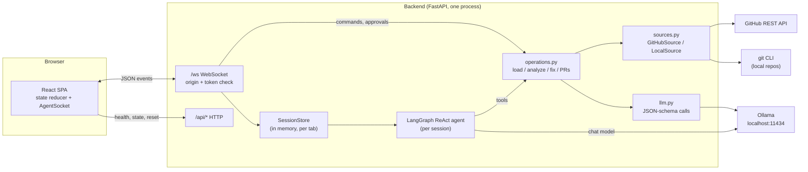
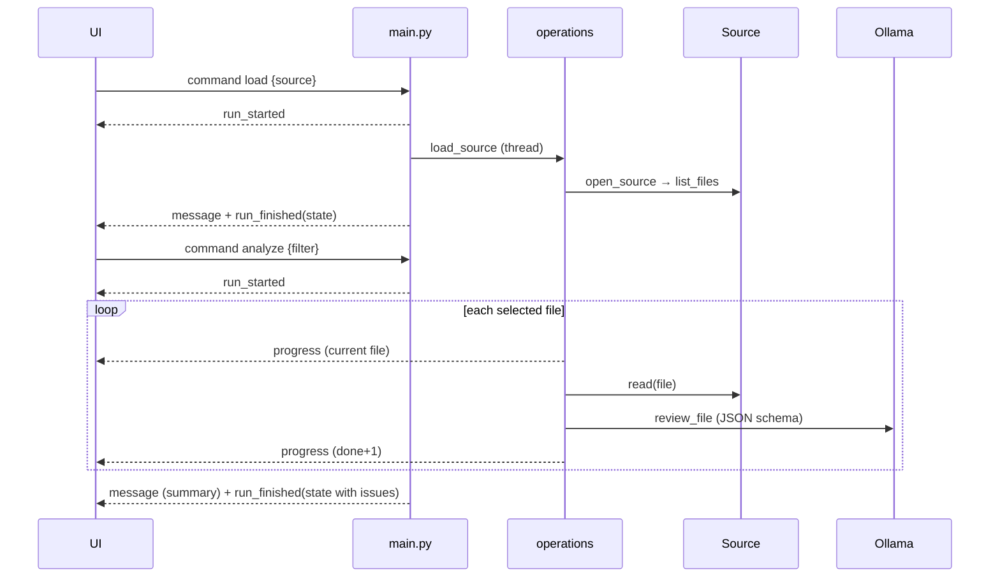
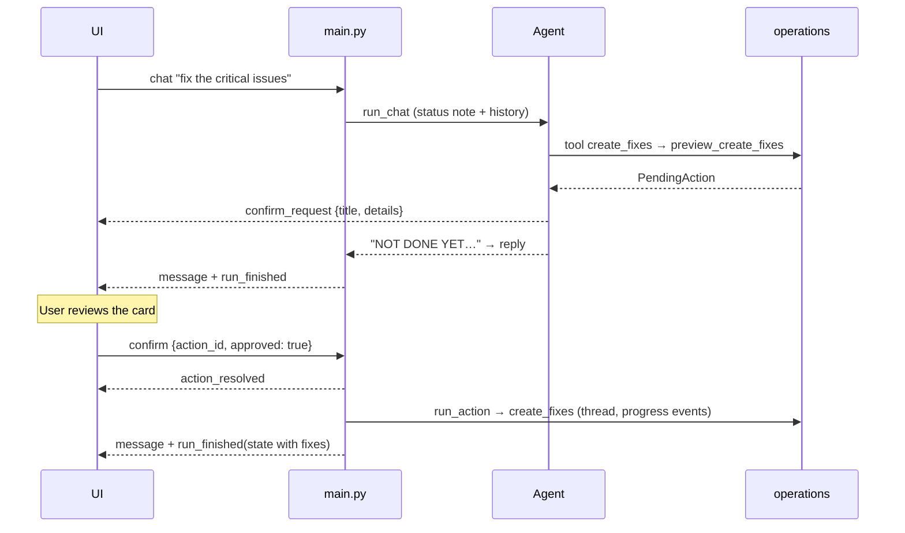
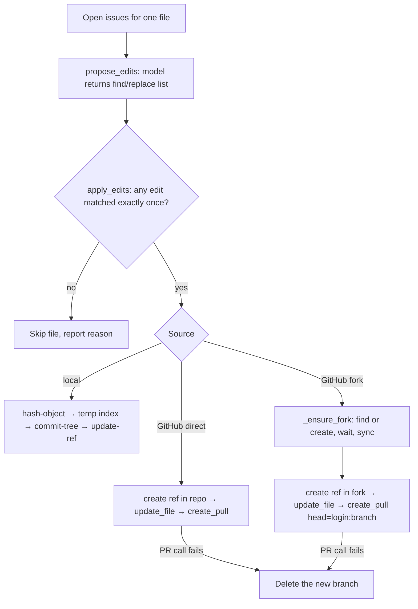

# RepoScan: Architecture and Knowledge Transfer

This document is for engineers who will maintain or extend RepoScan. It explains how the system is put together, why it was built this way, and where the sharp edges are. For setup and day-to-day use, see the [README](../README.md).

**Contents**

1. [What RepoScan is](#1-what-reposcan-is)
2. [System overview](#2-system-overview)
3. [Repository layout](#3-repository-layout)
4. [Backend in depth](#4-backend-in-depth)
5. [WebSocket protocol](#5-websocket-protocol)
6. [Key flows](#6-key-flows)
7. [Frontend in depth](#7-frontend-in-depth)
8. [Security model](#8-security-model)
9. [Design decisions](#9-design-decisions)
10. [Testing](#10-testing)
11. [Operations and troubleshooting](#11-operations-and-troubleshooting)
12. [How to extend](#12-how-to-extend)
13. [Known limitations and future work](#13-known-limitations-and-future-work)
14. [History](#14-history)

---

## 1. What RepoScan is

RepoScan reviews source code with a **local language model** and prepares fixes for human approval.

- **Input:** a GitHub repository (URL or `owner/repo`) or a folder on the machine running the backend.
- **Output:** a list of issues (severity, file, line, explanation), and, on request, fixes:
  - a pull request per file for GitHub repos, either from a branch in the repo or from the user's fork;
  - a git branch per file for local folders, without touching the working copy.
- **Interaction:** a chat with an agent that calls tools, plus buttons for the core steps.

Three non-negotiable product rules shape everything below:

1. **No code leaves the machine for an AI service.** The model runs in Ollama on localhost.
2. **Nothing is written without explicit approval.** The model can only *request* writes.
3. **A bad model answer must never damage a repository.** Edits are validated mechanically before anything is committed.

## 2. System overview



**Processes and ports**

| Process | Port | Notes |
| --- | --- | --- |
| Backend (`uvicorn app.main:app`) | 8000 | Binds to `127.0.0.1` by default. In production it also serves `frontend/dist`. |
| Frontend dev server (`npm run dev`) | 5173 | Development only. Talks to `http://localhost:8000`. |
| Ollama | 11434 | Must have the configured model pulled. |

**Two ways into the backend logic:**

- **Chat:** user text → agent → tools → `operations.py`.
- **Commands and approvals:** button clicks and Approve/Reject → `main.py` → `operations.py` directly, with no model in the loop.

Both paths end in the same operation functions, so behaviour is identical whichever the user picks.

## 3. Repository layout

```
backend/
  app/
    config.py       Settings dataclass, read once from env / backend/.env
    repo_utils.py   Pure functions: URL parsing, file selection, edit applier, slugs
    llm.py          Ollama client, review_file(), propose_edits(), model_status()
    sources.py      GitHubSource, LocalSource, decide_write_mode(), open_source()
    session.py      Session (per tab), PendingAction, SessionStore
    operations.py   Business logic, run in worker threads, return Markdown
    agent.py        Tool definitions, system prompt, run_chat()
    main.py         FastAPI app, WebSocket loop, run management, static files
  tests/            pytest: pure helpers, local git flows, GitHub write modes
  requirements.txt / requirements-dev.txt / .env.example / pytest.ini
frontend/
  src/
    lib/            types.ts (protocol types), socket.ts, api.ts, config.ts, format.ts, severity.ts
    state/          reducer.ts (all state transitions), AppProvider.tsx, context.ts
    components/
      layout/       TopBar (tabs, status, theme), HealthBanner
      sidebar/      Sidebar (source, actions, overview, status), SourceForm
      chat/         ChatView, MessageItem, ConfirmCard, RunStatus, Composer, EmptyState, Markdown
      issues/       IssuesView (grouped by file, filters, Fix file)
      fixes/        FixesView (PR links, git commands, discard)
      ui/           Button, Severity badges, Logo / GitHub mark
    index.css       Design tokens (dark + light) mapped into Tailwind v4 theme
docs/
  ARCHITECTURE.md   This file
  screenshots/      Images used by the README
.github/workflows/ci.yml   Backend tests + frontend lint/build
```

## 4. Backend in depth

### 4.1 `config.py`: settings

A single `Settings` dataclass built at import time from environment variables. `backend/.env` is loaded with `python-dotenv` and **does not override** variables already set in the environment, so `GITHUB_TOKEN= uvicorn …` really runs without a token. The dataclass is deliberately not frozen so tests can monkeypatch fields such as `local_roots`.

The full list of variables is in the README's Configuration table and in `backend/.env.example`.

### 4.2 `repo_utils.py`: pure helpers

No I/O, fully unit tested. Keep it that way.

| Function | Purpose |
| --- | --- |
| `parse_repo_url` | Accepts full URLs (with `.git`, `/tree/...`, surrounding text) and `owner/repo`. Repo names may contain dots. |
| `skip_reason` / `select_files` | Decide what gets reviewed: supported extensions only, no lockfiles, no vendored or build directories, no minified bundles, nothing above `MAX_FILE_CHARS`. `select_files` also applies the user's path filter and the `MAX_FILES` cap, and reports what was skipped and how much was left out. |
| `number_lines` | Adds a line-number gutter so the model can cite line numbers reliably. |
| `apply_edits` | The safety-critical piece, see [Decision 3](#d3-fixes-are-findreplace-edits-validated-mechanically). |
| `normalize_severity` / `highest_severity` | Coerce model output to the four known severities. |

### 4.3 `llm.py`: talking to the model

- Uses the official `ollama` Python client (`ollama.Client(host)`), cached with `lru_cache`.
- `_json_call()` sends a system and a user message with `format=<JSON schema>`, `think=False` (qwen3.5 would otherwise spend time on hidden reasoning) and `temperature=0`. `num_ctx` comes from settings. Any transport or JSON failure raises `ModelError` with a readable message.
- `review_file(path, content)` → list of issue dicts `{file, title, severity, line, description}`.
- `propose_edits(path, content, issues)` → `([{find, replace}], summary)`.
- `model_status()` → `{ok}` or `{ok: false, reason: ollama_unreachable | model_missing}`. It powers `/api/health` and the UI banner.
- Every prompt includes `UNTRUSTED_NOTE`, which tells the model that file content is data, never instructions.

### 4.4 `sources.py`: where code comes from and where fixes go

Both source classes expose the same duck-typed interface, which `operations.py` relies on:

| Member | GitHubSource | LocalSource |
| --- | --- | --- |
| `kind` | `"github"` | `"local"` |
| `label`, `location`, `branch`, `base_sha`, `notes` | repo name, URL, default branch, its head commit | folder name, path, current branch, `HEAD` |
| `list_files()` | Git tree API (recursive) at `base_sha` | `git ls-tree -r -l -z HEAD` (or a filesystem walk if not a git repo) |
| `read(item)` | Blob API, binary files return `None` | `git cat-file blob <sha>` (or a file read) |
| `write_mode` | `"direct"`, `"fork"` or `None` | `"branch"` or `None` |
| `write_blocker` | Reason fixes are impossible, or `None` | Same |
| `create_fix(item, content, branch, title, body)` | branch + commit + PR | branch + commit via plumbing |
| `discard_fix(fix)` | close PR, delete branch (in repo or fork) | delete branch ref |

**Always the same base commit.** Both sources pin `base_sha` at load time. Files are read at that commit and fixes branch from it, so a fix always applies to exactly the code that was reviewed. If the upstream file changed since, GitHub rejects the update (stale blob SHA) and that file is reported as skipped.

**GitHub write modes.** `decide_write_mode(token, can_push, archived, label)` is a pure function, unit tested in `tests/test_write_mode.py`:

| Condition | Mode | Result |
| --- | --- | --- |
| No token | `None` | Read only. Blocker: add `GITHUB_TOKEN`. |
| Repo archived | `None` | Read only. |
| Token can push (`permissions.push`, `maintain` or `admin`) | `direct` | Branch in the repo, PR from it. |
| No push, fine-grained token (`github_pat_…`) | `None` | Read only. Blocker explains that fine-grained tokens can't open PRs on repos the user doesn't own. |
| No push, classic token | `fork` | Branch in the user's fork, PR to the original. |

Token type is inferred from the prefix (`ghp_` classic, `github_pat_` fine-grained). This avoids an extra API call and lets the UI explain the problem before the user tries.

**Fork flow** (`_ensure_fork`):

1. Look for `<login>/<repo-name>`. If it exists but isn't a fork of this repo, stop with a clear error rather than writing to an unrelated repo.
2. Otherwise call `create_fork(default_branch_only=True)`. GitHub returns the existing fork if the user already has one under another name.
3. Forks are created asynchronously and older forks can lag, so poll up to 30 times, 2 seconds apart, until `base_sha` is visible in the fork, calling `merge_upstream` between attempts.
4. Push the branch to the fork and open the PR on the original repo with `head="<login>:<branch>"` and `maintainer_can_modify=True`.

If the PR call fails, the branch that was just created is deleted, so failures leave nothing behind.

**Local folders.** `LocalSource` refuses paths outside `LOCAL_ROOTS`. It resolves the path, then uses `git rev-parse --show-toplevel`, so a subfolder maps to its repo root. Fixes are committed without touching the user's checkout:

```
blob   = git hash-object -w --stdin            < fixed content
GIT_INDEX_FILE=<tmp> git read-tree <base_sha>   # private temporary index
GIT_INDEX_FILE=<tmp> git update-index --cacheinfo <mode>,<blob>,<path>
tree   = GIT_INDEX_FILE=<tmp> git write-tree
commit = git commit-tree <tree> -p <base_sha> -m <message>
git update-ref refs/heads/<branch> <commit> ""  # "" = fail if the branch exists
```

Uncommitted changes are deliberately not reviewed; RepoScan reviews `HEAD` and adds a note when the tree is dirty. Non-git folders can be reviewed but not fixed. Symlinks are skipped in both modes.

### 4.5 `session.py`: state per browser tab

- **`Session`** holds everything for one tab: `source`, `files`, `file_contents` (contents of reviewed files, needed later for fixes), `issues`, `fixes`, `analysis` (stats of the last run), `history` (chat, capped at `HISTORY_LIMIT`), `pending` (approvals waiting), the lazily built `agent`, and run control (`task`, `cancel_event`).
- `reset()` clears everything, while `reset_repo()` keeps the conversation. Loading a new source uses `reset_repo()`.
- **`emit(payload)`** is thread-safe: it uses `loop.call_soon_threadsafe` to put events on the connection's `asyncio.Queue`. Worker threads report progress through it. With no connection attached, events are dropped.
- **`new_run()`** creates a fresh `threading.Event` per run. Operations capture the event at start, so stopping one run can never cancel the next.
- **`SessionStore`** keeps up to 200 sessions in an `OrderedDict` (LRU) and never evicts a busy session. Session IDs must match `^[A-Za-z0-9-]{8,64}$`.
- **`PendingAction`** has `kind`, `params` (kept server-side and never sent to the client), `title`, `details` and `destructive`.

### 4.6 `operations.py`: the business logic

All functions are synchronous, run in worker threads via `asyncio.to_thread`, return Markdown for the chat, and raise `SourceError` for problems the user should read.

| Function | Notes |
| --- | --- |
| `load_source` | Opens the source, lists files, summarises what can be reviewed, adds the source's notes. |
| `analyze` | `ThreadPoolExecutor(ANALYZE_CONCURRENCY)`. Checks the cancel flag between files, emits `progress` before and after each file, and collects per-file errors without stopping. If **every** file failed, it raises the first error, typically "Ollama unreachable". Issues are replaced only for the files reviewed in this run, then re-sorted by severity, file and line and renumbered from 1. |
| `show_issues`, `explain_issue` | Read-only formatting for the agent. |
| `preview_create_fixes` → `create_fixes` | Groups open issues by file. Per file: `propose_edits` → `apply_edits` → `create_fix`. Files with zero applied edits are skipped with the reason. Issues covered by a fix get `status: "fixed"`. |
| `preview_discard_fixes` → `discard_fixes` | Undo RepoScan's own fixes and reopen their issues. |
| `list_prs`, `get_pr` | Read-only. |
| `preview_close_pr`, `preview_close_all`, `preview_merge_pr` → `close_prs`, `merge_pr` | Need write access (`_require_manage`). "Close all" stores the exact PR numbers at preview time. |
| `run_action` | Dispatches an approved `PendingAction` by `kind`. |

### 4.7 `agent.py`: the chat agent

- `create_react_agent` (LangGraph prebuilt) with `ChatOllama(reasoning=False, temperature=0.1)`. One agent is built per session because the tools are closures over that session.
- **Tools.** Read tools return data. Write tools (`create_fixes`, `discard_fixes`, `close_pull_request`, `close_all_pull_requests`, `merge_pull_request`) call a `preview_*` function, register the `PendingAction`, and return a message that starts with "NOT DONE YET". Small models otherwise tend to claim the work is finished.
- The `guarded` decorator turns `SourceError` into `"Error: …"` text the model can relay. It uses `functools.wraps`, which LangChain needs to read the signature and docstring. Docstrings are the tool descriptions.
- **Status note.** Each turn inserts a `SystemMessage` describing the current state ("repo X loaded, analysis done, N open issues…"). Without it, the 9B model re-ran `load_repo` and `analyze_files` on follow-up questions.
- `recursion_limit` is 16, which caps runaway tool loops.
- Emits a `tool_call` event per tool call, so the UI can show what the agent is doing.

### 4.8 `main.py`: API and run management

- **CORS** allows only `ALLOWED_ORIGINS`, for `GET`, `POST` and `DELETE`.
- **HTTP endpoints:**

| Endpoint | Purpose |
| --- | --- |
| `GET /api/health` | Model status, model name, whether a GitHub token is set, limits. No session needed. |
| `GET /api/state` | Session snapshot. Needs the `X-Session-ID` header. |
| `DELETE /api/state` | Reset the session. Returns 409 while a task is running. |

- **WebSocket `/ws?session=…&token=…`.** Browsers don't apply CORS to WebSockets, so the `Origin` header is checked by hand before `accept()`. Bad origins, tokens or session IDs close with code 1008, and invalid JSON closes with 1003.
- **One writer per connection.** A single task drains the session's outbox queue and is the only code that calls `send_json`. That avoids concurrent sends on one socket.
- **`_start_run(session, kind, label, work)`** is the only way work starts. It allows one task per session (otherwise it emits an error), always emits `run_started`, then `message`, `error` or `interrupted`, and **always** `run_finished` with a fresh snapshot. Non-chat results are added to the chat history so the agent knows what the buttons did.
- **Disconnects don't cancel work.** A reload reconnects with the same session ID (sessionStorage), receives `hello` with `busy: true` and pending approvals, and keeps getting progress.
- If `frontend/dist` exists, it is mounted at `/`, so production runs as one process.

## 5. WebSocket protocol

All messages are JSON objects with a `type`. TypeScript definitions are in `frontend/src/lib/types.ts` (`ServerEvent`, `Command`).

**Client → server**

| `type` | Fields | Effect |
| --- | --- | --- |
| `chat` | `message` (max 4,000 chars) | Starts an agent run |
| `command` | `name`: `load` (`args.source`), `analyze` (`args.filter`), `create_fixes` (`args.severity`, optional `args.file`), `discard_fix` (`args.fix_id`) | Starts a run without the model. `create_fixes` only produces a preview and an approval card. |
| `confirm` | `action_id`, `approved` | Resolves a pending action. If approved, starts an `action` run. |
| `interrupt` | none | Sets the cancel flag and cancels the task |
| `ping` | none | Heartbeat, sent every 25 seconds |

**Server → client**

| `type` | Fields | When |
| --- | --- | --- |
| `hello` | `state`, `model` | On connect, including after a reconnect |
| `run_started` | `kind` (`chat`, `command`, `action`), `label` | A run begins |
| `tool_call` | `tool`, `args` | The agent called a tool |
| `progress` | `phase` (`analyze`, `fix`), `done`, `total`, `current` | During analysis and fixing |
| `confirm_request` | `action` (`id`, `kind`, `title`, `details`, `destructive`) | A write needs approval |
| `action_resolved` | `action_id`, `approved` | Approval decided |
| `message` | `kind`, `label`, `content` (Markdown), `tools` | A run's result |
| `error` | `message` | User-readable failure |
| `interrupted` | none | The run was stopped |
| `run_finished` | `state` (snapshot, `busy: false`) | Always last in a run |
| `pong` | none | Heartbeat reply |

**Snapshot shape** (`Session.snapshot()`): `{source, issues, fixes, analysis, pending, busy}`. `source` includes `kind`, `label`, `location`, `branch`, `commit`, `file_count`, `write_blocker`, `write_mode`, `fork` and `notes`.

## 6. Key flows

### 6.1 Load and analyze (buttons)



### 6.2 Chat request that needs approval



The model never sees the approval and never runs the write itself. The approved action runs straight from `main.py`.

### 6.3 Creating one fix



## 7. Frontend in depth

**Stack:** React 19, TypeScript (strict, `verbatimModuleSyntax`), Vite 8, Tailwind CSS v4, lucide-react icons, react-markdown with remark-gfm, sonner for toasts.

**State.** There's no external state library. `state/reducer.ts` is the single place where state changes:

- `snapshot` is the server's truth (source, issues, fixes, analysis, pending). It is replaced wholesale on `hello` and `run_finished`.
- `items` is the chat transcript: `user`, `agent`, `error`, `notice` and `confirm` items. It is persisted to `sessionStorage` (last 200) so a reload keeps the conversation.
- `run` is the current task: label, tools called, progress. It drives `RunStatus` and disables inputs.
- `connection` and `health` drive the status dot and `HealthBanner`.
- `syncConfirmCards` reconciles approval cards with `snapshot.pending`. It adds missing cards after a reconnect and marks stale ones as not approved.
- On `message`, approval cards raised during that run are moved below the reply, so the explanation reads before the card.

**Socket.** `lib/socket.ts` holds `AgentSocket`: exponential reconnect (500 ms doubling, capped at 10 s), a 25-second heartbeat, and the session ID and optional token in the query string. `AppProvider` owns one socket and exposes `actions` (`sendChat`, `runCommand`, `confirm`, `interrupt`, `newSession`, `refreshHealth`) through context. Health is polled every 15 seconds while the model is unavailable or the socket is down.

**Session identity.** `lib/config.ts` stores a UUID in `sessionStorage`, so each tab is a separate session and a reload keeps it. Note that "Duplicate tab" in most browsers copies `sessionStorage`, so a duplicated tab shares the session. The newest connection then receives the events.

**Layout.**
- Sidebar: source card with access badge, actions, overview, model and GitHub status. It becomes a drawer below the `lg` breakpoint.
- Top bar: Chat, Issues and Fixes tabs, connection status, theme toggle, new session.
- Clicking an action in the sidebar or Issues tab switches to Chat, where progress and approvals appear.

**Theming.** `index.css` defines CSS variables for dark (default) and light, selected by `prefers-color-scheme` or forced with `<html data-theme>`. The choice is stored in `localStorage` and applied by an inline script before first paint, to avoid a flash. The variables are mapped into Tailwind through `@theme inline`, so components use semantic classes (`bg-panel`, `text-fg-muted`, `text-sev-critical`) and never raw colors. Global base styles sit in `@layer base`; unlayered CSS would override Tailwind utilities.

**Lint rules to respect.**
- `react-refresh/only-export-components`: component files export only components, which is why constants live in `lib/`.
- `react-hooks/set-state-in-effect`: derive values during render instead of syncing them in effects.

## 8. Security model

RepoScan holds two powerful things: a GitHub token, and the ability to write git refs on the local machine. The threats and their mitigations:

| Threat | Mitigation | Where |
| --- | --- | --- |
| A malicious website drives the backend through the user's browser (cross-site WebSocket hijacking) | `Origin` allowlist checked before `accept()`. CORS allowlist for HTTP. Optional `REPOSCAN_API_TOKEN`, compared in constant time. | `main.py` |
| The model, or prompt injection inside a scanned repo, triggers destructive actions | Write tools only create `PendingAction`s. Execution needs a `confirm` message from the UI. The model cannot approve. | `agent.py`, `main.py` |
| An approval is replayed or changed | Action parameters stay server-side. The client only sends the action ID, and each ID can be used once (`pending.pop`). | `session.py`, `main.py` |
| "Close all PRs" closes PRs opened after the user looked | The preview stores exact PR numbers, and execution closes only those. | `operations.py` |
| An AI fix deletes or garbles code | Exact-match find/replace, at most 50% of a file per edit, whole files only (no truncation). | `repo_utils.py`, `llm.py` |
| Reading arbitrary local files | `LOCAL_ROOTS` allowlist, resolved paths, symlinks skipped, only code extensions reviewed. | `sources.py` |
| Writing to repos the user doesn't own | Never pushes there. Writes go to the user's own fork, and the original only gets a PR. Unrelated same-name repos are refused. | `sources.py` |
| Deleting other people's branches | Branch deletion only for same-repo heads. Fork branches of contributors are never touched. | `sources.py` |
| Token leakage | `.env` is gitignored. The token is never sent to the frontend; only a boolean is. | `config.py`, `main.py` |
| Network exposure | Binds to `127.0.0.1` by default. The README warns to set a token and origins before exposing it. | README |

**Residual risks:**
- Anything running locally as the same user can reach `127.0.0.1:8000` without an `Origin` header check. That's acceptable, because such a process could read `.env` anyway.
- The local model may produce subtly wrong but valid-looking fixes. Human review of each PR or branch is the control.

## 9. Design decisions

Each entry records the decision, why it was made, the alternatives, and the consequences.

### D1. Local model through Ollama, not a cloud API
- **Why:** a product requirement. Code must not leave the machine, and there should be no API keys or per-token cost.
- **Alternatives:** OpenAI or another cloud API (the original version); llama.cpp or LM Studio directly.
- **Consequences:** quality and speed depend on local hardware, roughly 10 to 60 seconds per file on an M2 Pro with a 9B model. All prompts and formats are designed for a small model (D2, D3, D8, D12). Any Ollama model with tool support can be swapped in through `OLLAMA_MODEL`.

### D2. Structured output with JSON schemas
- **Why:** the original version parsed free text with regexes, which silently lost or misread issues (for example `SEVERITY: **High**`). Ollama's `format=<schema>` constrains generation, so the output always parses.
- **Consequences:** severities are an enum, and line numbers are integers or null. `normalize_severity` remains as a second line of defence.

### D3. Fixes are find/replace edits validated mechanically
- **Why:** the original version asked for the whole fixed file and committed it, after cutting the input to 15,000 characters. Large files were committed truncated. Whole-file rewrites are also slow on a local model, and small models drop code.
- **How:** the model returns `{find, replace}` pairs. `apply_edits` applies an edit only if `find` occurs exactly once and covers at most half of a file over 400 characters. If no edit applies, the file is skipped.
- **Alternatives:** unified diffs (small models produce malformed hunks often); whole files with a length heuristic (still lossy).
- **Consequences:** a fix can be partial when some edits are rejected. Rejected edits are listed in the PR body under "Edits not applied".

### D4. The approval gate lives outside the model
- **Why:** prompt-only safeguards ("ask before merging") fail with small models and under prompt injection. The original exposed `merge_pr` and `delete_all_prs` directly.
- **How:** write tools create a `PendingAction` and return immediately. Only a `confirm` message from the UI executes it, through `run_action`, without the model.
- **Alternatives:** LangGraph `interrupt()` with a checkpointer. It's heavier, and the model would resume after approval, which adds latency and another chance to misbehave.
- **Consequences:** the model must be told clearly that nothing happened yet (the "NOT DONE YET" text).

### D5. Buttons for the core flow, alongside chat
- **Why:** a 9B model sometimes chooses the wrong tool or re-runs work. The main path (load, analyze, fix) must not depend on it.
- **Consequences:** two entry points (commands and tools) share `operations.py`. Command results are added to the agent's history.

### D6. Local fixes via git plumbing on new branches
- **Why:** writing to the working tree or switching branches would disturb the user's work in progress.
- **How:** a temporary index, `commit-tree`, and `update-ref` with an empty expected old value, so a branch is never overwritten.
- **Consequences:** fixes are based on `HEAD`, so uncommitted changes are neither reviewed nor included. Non-git folders are read only.

### D7. Pin a base commit per load
- **Why:** files must be reviewed and fixed against the same content, and GitHub's "update file" needs the blob SHA.
- **Consequences:** if the branch moves after loading, fixes are still based on the old commit. They show up as PRs or branches behind the default branch. Reloading the source picks up the new head.

### D8. One PR or branch per file
- **Why:** the original made one PR per issue, so several PRs edited the same file and conflicted. Per file is reviewable, and independent merges don't conflict.
- **Consequences:** a file with many issues gets one larger PR, and its body lists every issue.

### D9. Fork-based PRs, and fine-grained tokens detected by prefix
- **Why:** contributing to repos you can't push to is normal on GitHub. Failing halfway through a batch is a bad experience, so access is decided at load time.
- **Consequences:** a fork is created in the user's account on first use. Detection relies on GitHub's token prefixes. If GitHub changes them, `decide_write_mode` needs updating. Fork mode is covered by tests with stand-in objects, not against live GitHub.

### D10. WebSocket with a typed event protocol
- **Why:** runs are long and produce many kinds of events (progress, tool calls, approvals). The client also needs to send interrupts and approvals mid-run.
- **Alternatives:** server-sent events plus POST requests (the original frontend had a leftover SSE client for an endpoint that never existed).
- **Consequences:** browsers don't apply CORS to WebSockets, so the origin check in D11 is required.

### D11. Origin allowlist plus an optional token
- **Why:** without it, any web page could open `ws://localhost:8000/ws` and act with the user's GitHub token.
- **Consequences:** serving the UI from a different origin requires adding it to `ALLOWED_ORIGINS`.

### D12. Sessions in memory, one per tab
- **Why:** the original used one global state object, so tabs overwrote each other. A database is unnecessary for a single-user local tool.
- **Consequences:** restarting the backend loses sessions; the UI keeps its transcript but the server state is empty. Not suitable for multi-instance deployment without moving sessions to shared storage.

### D13. Default concurrency of 1
- **Why:** on typical laptops Ollama handles one request at a time (it picks `OLLAMA_NUM_PARALLEL` from available memory), so parallel requests mostly queue and compete for memory.
- **Consequences:** analysis is sequential. Users with `OLLAMA_NUM_PARALLEL` set can raise `ANALYZE_CONCURRENCY`.

### D14. Skip oversized files instead of truncating them
- **Why:** truncated input produced truncated fixes in the original. Partial context also yields wrong findings.
- **Consequences:** big files (default limit 24,000 characters) are skipped and reported. Raise `MAX_FILE_CHARS` together with `OLLAMA_NUM_CTX`.

### D15. Inject a state note on every chat turn
- **Why:** the chat history only contains text, so the model lost track of what was already loaded or analyzed and redid it.
- **Consequences:** a few extra tokens per turn, and noticeably fewer redundant tool calls.

### D16. Disconnects don't cancel runs
- **Why:** a page reload in the middle of a multi-minute analysis shouldn't throw the work away.
- **Consequences:** a run can continue with nobody watching. The user can reconnect and press Stop.

## 10. Testing

```bash
cd backend && python -m pytest        # 24 tests, about 1 second, no network or model
cd frontend && npm run lint && npm run build
```

| Test file | Covers |
| --- | --- |
| `test_repo_utils.py` | URL parsing (dots, `.git`, paths), severity normalization, file selection and caps, `apply_edits` rejecting missing, ambiguous or oversized edits |
| `test_local_source.py` | Real temporary git repos: listing and reading at `HEAD`; creating a fix branch leaves the checked-out branch, working tree and uncommitted files untouched; discarding; `LOCAL_ROOTS` enforcement; non-git folders are read only |
| `test_write_mode.py` | `decide_write_mode` for every token and access combination; `create_fix` in direct and fork modes with stand-in GitHub objects (correct `head`, `maintainer_can_modify`, cleanup on failure) |

**Not covered by automated tests,** so verify these manually after related changes:
- Live GitHub writes (direct and fork). Use a throwaway repo and a test token.
- Model quality. Run the app against a small repo with known bugs, such as `we45/Vulnerable-Flask-App`.
- The UI. There are no component tests yet. The release check is a manual walkthrough: load, analyze, ask a question, approve fixes, discard a fix, light theme, mobile width.

CI (`.github/workflows/ci.yml`) runs the backend tests on Python 3.13, and the frontend lint and build on Node 22.

## 11. Operations and troubleshooting

**Logs.** The backend logs to stdout through Python logging (`reposcan` logger) and uvicorn. Per-file review failures are logged as warnings and summarised in the chat.

| Symptom | Likely cause | Fix |
| --- | --- | --- |
| Banner: "Ollama isn't running" | The Ollama app or service is stopped | Open Ollama or run `ollama serve` |
| Banner: model isn't downloaded | Model not pulled | `ollama pull <OLLAMA_MODEL>` |
| Banner: can't reach backend | Backend down or on another port | Start uvicorn, or set `VITE_API_URL` |
| WebSocket closes immediately (code 1008) | Origin not in `ALLOWED_ORIGINS`, token mismatch, or bad session ID | Add the origin, or align `REPOSCAN_API_TOKEN` and `VITE_API_TOKEN` |
| "GitHub rejected GITHUB_TOKEN" | Expired or revoked token | Create a new token |
| Badge says "Read only" on a public repo | No token, a fine-grained token on someone else's repo, or an archived repo | See the README section on which repos you can open PRs on |
| "Your fork … isn't ready or is out of date" | Fork still being created, or it diverged | Sync the fork on GitHub and retry |
| A file is skipped with "text not found" | The model's `find` text didn't match the file exactly | Retry, or fix by hand. A bigger model helps. |
| Analysis is very slow or the Mac swaps | Context too large for available RAM | Lower `OLLAMA_NUM_CTX` and `MAX_FILE_CHARS`, or use a smaller model |
| "Still working on the last request" | One run per session | Wait, or press Stop |

## 12. How to extend

**Add a read-only agent tool.**
1. Write the logic in `operations.py`. Return Markdown, and raise `SourceError` for user-facing problems.
2. Wrap it in `build_tools()` in `agent.py` with `@tool` and `@guarded`, a precise docstring and typed parameters.
3. Add a friendly label in `frontend/src/lib/format.ts` (`TOOL_LABEL`).

**Add a write action.**
1. Add a `preview_<name>()` that validates and returns a `PendingAction` with a clear `title` and `details`, and `destructive=True` if it's hard to undo.
2. Add the executor, and a branch for it in `run_action()`.
3. Add an agent tool that calls `session.request_action(preview(...))` and returns `_approval(action)`.
4. If it needs a button, add a `command` case in `main.py`, a `Command` variant in `types.ts`, and call `actions.runCommand` from the UI.

**Add a new source** (for example GitLab). Implement the interface in [4.4](#44-sourcespy-where-code-comes-from-and-where-fixes-go) and route to it from `open_source()`. Add `write_mode` and `fork_name`, which `Session.source_info()` reads, and extend `SourceInfo['kind']` and the sidebar icon.

**Change the model.** Set `OLLAMA_MODEL`. The model must support tool calling for chat, and JSON-schema output for review and fixes. For models without hidden reasoning, `think=False` and `reasoning=False` are harmless.

**Change review rules.** File filters are in `repo_utils.py` (`CODE_EXTENSIONS`, `LOCKFILES`, `IGNORED_DIRS`). Review guidance is in the system prompt in `llm.review_file`.

## 13. Known limitations and future work

**Limitations**
- Model quality: false positives and missed subtle bugs. Fixes can be partial.
- Sessions are in memory only, and there is no multi-user support or authentication beyond the optional shared token.
- One analysis run covers at most `MAX_FILES` files, and big files are skipped.
- GitHub trees larger than the API limit are truncated (a note is shown).
- Fixes don't run the project's tests or linters before committing.

**Ideas, roughly in order of value**
1. Show the diff of each proposed fix inside the approval card before anything is pushed.
2. Run the project's formatter, linter or tests on the fixed file, and reject the fix if they fail.
3. Persist sessions (SQLite) so a backend restart keeps issues and fixes.
4. Review only files changed in a branch or PR ("review this PR").
5. Stream the agent's reply token by token.
6. Frontend component tests (Vitest and Testing Library) and a Playwright smoke test in CI.
7. Cache reviews by blob SHA, so unchanged files aren't sent to the model again.

## 14. History

**v1 (original).** A single-file FastAPI backend (`main.py`) using OpenAI GPT-4o, with one global state object and a regex-parsed review format. Whole-file fixes were cut to 15,000 characters, there was one PR per issue, and destructive tools were exposed to the model without confirmation. CORS allowed every origin. The frontend used inline styles throughout.

**v2 (this architecture).**
- Ollama local model.
- A modular backend with per-tab sessions.
- An approval gate for every write.
- Find/replace fixes with validation.
- Local-folder support with plumbing commits.
- Fork-based PRs with up-front access checks.
- An origin and token check on the WebSocket.
- JSON-schema outputs.
- Live progress and real cancellation.
- A rebuilt Tailwind UI with design tokens, light and dark themes, and a mobile layout.
- Tests and CI.
